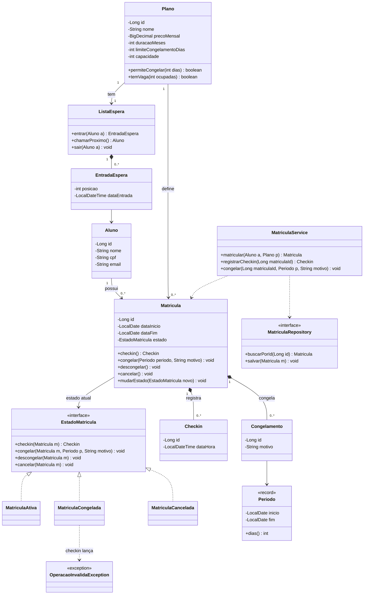

# Diagrama de classes: Academia e Planos (AV2_D2_A)

Código Mermaid. O GitHub e o GitLab renderizam este bloco automaticamente; também dá para colar em https://mermaid.live para exportar PNG ou SVG.
Os tipos seguem o estilo Java; ajuste para a linguagem usada na disciplina.

